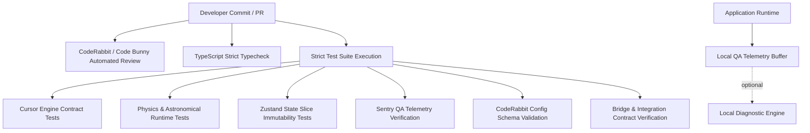

# Silver Wolf VI — QA & Development Architecture

This document describes local QA checks and the hosted review/dependency services configured for **Silver Wolf VI**. Local contract checks do not prove that GitHub-hosted services ran successfully.

---

## 1. QA Architecture Overview



---

## 2. Sentry QA & Telemetry

The current browser telemetry path is local and does not deliver events to Sentry:

- **Client-Side Telemetry (`src/core/qa/sentryQA.ts`)**:
  - Captures unhandled exceptions and stores bounded breadcrumbs locally.
  - Maintains a sliding-window buffer of 50 structured breadcrumbs (UI actions, network updates, state mutations).
  - Operates without a DSN; the UI must describe it as a local buffer, not a Sentry connection.
- **React Error Boundaries (`src/components/common/ErrorBoundary.tsx`)**:
  - React component subtree exceptions are caught gracefully and reported to `sentryQA` with event IDs.
- **Browser remote delivery**: Not implemented by the browser service. A configured browser DSN is not proof of event delivery; the browser UI describes it as a local buffer.
- **Python FastAPI Bridge (`bridge/server.py`)**: Uses the official `sentry-sdk[fastapi]` when `SENTRY_DSN` is configured. Without the package or DSN, bridge telemetry stays disabled. Hosted event delivery still needs a live DSN-backed check.

---

## 3. CodeRabbit (Code Bunny) AI Code Review

Automated pull-request review policies are defined in `.coderabbit.yaml`:

- **Profile**: Assertive QA.
- **Request Changes**: Enabled for policy or test contract violations.
- **Path-Specific Policies** (seven configured paths):
  - `src/core/state/**`: Strict Zustand slice isolation & immutability.
  - `src/core/qa/**`: Zero swallowed exceptions & mock mode safety.
  - `src/components/**`: Error boundary wrapping & design token adherence.
  - `bridge/**`: Local-first model prioritization & token efficiency.
  - `src/plugins/**`: Plugin cleanup and resilient network handling.
  - `src/lib/**`: Numerical and input edge cases.
  - `scripts/**`: Strict assertion coverage.

The in-app CodeRabbit panel reports configured policy paths only. It cannot report the hosted CodeRabbit review status for a commit.

## 4. Dependabot

`.github/dependabot.yml` checks npm dependencies weekly, groups patch/minor updates, and keeps major updates separate. The local suite can validate repository configuration but cannot determine whether GitHub currently has Dependabot alerts or blocked update PRs.

---

## 5. Test Commands

Run the test suite using the standard npm scripts:

```bash
# Run all strict contract & unit tests
npm test

# Run strict test suite alias
npm run test:strict

# Run typecheck and full QA verification
npm run qa:check

# Run Vitest test runner
npm run test:vitest
```
