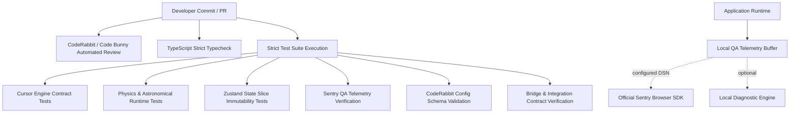

# Silver Wolf VI — QA & Development Architecture

This document describes local QA checks and the hosted review/dependency services configured for **Silver Wolf VI**. Local contract checks do not prove that GitHub-hosted services ran successfully.

---

## 1. QA Architecture Overview



---

## 2. Sentry QA & Telemetry

Browser diagnostics and React error boundaries share an official Sentry browser
client. With no valid DSN, diagnostics remain local and startup does not depend on
Sentry availability.

- **Client-Side Telemetry (`src/core/qa/sentryQA.ts`)**:
  - Captures unhandled exceptions and stores bounded breadcrumbs locally.
  - Maintains a sliding-window buffer of 50 structured breadcrumbs (UI actions, network updates, state mutations).
  - Operates without a DSN; configuration and HTTP delivery are separate states.
- **React Error Boundaries (`src/components/common/ErrorBoundary.tsx`)**:
  - React component subtree exceptions are caught gracefully and reported to `sentryQA` with event IDs.
- **Browser remote delivery**: `src/services/sentryService.ts` uses `@sentry/browser` with a dedicated client and the existing diagnostic listeners. Automatic console, form, session, tracing and replay capture are disabled. Arbitrary diagnostic metadata, request data and user context remain local; common credential patterns and URL queries are redacted from remote messages. Captured events and successful HTTP submissions are counted separately. A successful submission still needs confirmation in the Sentry project before claiming hosted ingestion.
- **Python FastAPI Bridge (`bridge/server.py`)**: Uses the official `sentry-sdk[fastapi]` when `SENTRY_DSN` is configured. Without the package or DSN, bridge telemetry stays disabled. Hosted event delivery still needs a live DSN-backed check.

---

## 3. CodeRabbit (Code Bunny) AI Code Review

Automated pull-request review policies are defined in `.coderabbit.yaml`:

- **Profile**: Assertive QA.
- **Request Changes**: Enabled for policy or test contract violations.
- **Path-Specific Policies** (seven configured paths):
  - `src/core/state/**`: Strict Zustand slice isolation & immutability.
  - `src/core/qa/**`: Zero swallowed exceptions & mock mode safety.
  - `src/components/**`: Error boundary wrapping & design token adherence.
  - `bridge/**`: Local-first model prioritization & token efficiency.
  - `src/plugins/**`: Plugin cleanup and resilient network handling.
  - `src/lib/**`: Numerical and input edge cases.
  - `scripts/**`: Strict assertion coverage.

The in-app CodeRabbit panel reports configured policy paths only. It cannot report the hosted CodeRabbit review status for a commit.

Automatic review is explicitly enabled for non-draft PRs to `main`. Install or
enable the [CodeRabbit GitHub app](https://github.com/apps/coderabbitai) for
`jckx15-13/HuTao-Software` and check the repository appears in the CodeRabbit
account. YAML alone cannot install an app, grant repository access or assign an
account seat. Completion requires a hosted check or review on the current PR SHA.

## Hosted integration setup and verification

For Sentry, configure GitHub Actions with `SENTRY_AUTH_TOKEN` (secret),
`SENTRY_ORG`, `SENTRY_PROJECT`, and `VITE_SENTRY_DSN` (secrets or variables for the
last three). The DSN is browser-visible; an auth token must never be prefixed
`VITE_` or included in the client bundle.

The Pages workflow builds hidden source maps, injects debug IDs and uploads maps
from that exact build, then removes `.map` files before publishing. The deployed
client uses the commit SHA as its release. If a browser DSN is configured but
upload credentials are incomplete, deployment fails with the missing setting.
Without a DSN, the build records that Sentry is disabled. Manual execution of
Ultimate QA Pipeline verifies the supplied Sentry credentials with `sentry-cli`.

After deployment, capture one identifiable test exception and confirm its event
ID and readable stack trace in the intended Sentry project. No synthetic event
is sent automatically on page load.

Chromatic now waits for test completion (`exitOnceUploaded: false`) and fails on
unaccepted changes (`exitZeroOnChanges: false`, `autoAcceptChanges: false`). A
previous upload-only success did not establish that all visual tests passed.
Review intentional diffs in Chromatic before accepting a new baseline. Existing
Storybook coverage defines which components receive visual tests.

## 4. Dependabot

`.github/dependabot.yml` checks npm dependencies weekly, groups patch/minor updates, and keeps major updates separate. The local suite can validate repository configuration but cannot determine whether GitHub currently has Dependabot alerts or blocked update PRs.

---

## 5. Test Commands

Run the test suite using the standard npm scripts:

```bash
# Run all strict contract & unit tests
npm test

# Run strict test suite alias
npm run test:strict

# Run typecheck and full QA verification
npm run qa:check

# Run Vitest test runner
npm run test:vitest
```
